# 校园网 · 广东天翼校园网 Android 客户端

对广东天翼校园网（`cdcportal` / `portal` 认证）的**轻量级** Android 客户端。
协议来自参考后端 [Hoshi0008/ESurfing](https://github.com/Hoshi0008/ESurfing)，本工程把它完整移植到了 Android（纯 Java + Android Framework，**零第三方依赖**）。

- **安装包 122 KB**（release，R8 + 资源压缩）——远低于 1 MB
- **后台长期驻留**：前台服务 + 常驻通知 + START_STICKY + 开机自启 + 15 分钟看门狗 + 电池优化白名单引导
- **磨砂玻璃 UI**：圆角半透明卡片、真实高斯模糊（GPU `RenderEffect`）、弹窗由小到大弹出、暗黑模式
- **配置持久化**：`files/esurfing.conf`，键名与参考后端完全一致，可从 PC 端直接迁移
- **日志**：`ESurfing 年-月-日-时-分-秒.log`（时间为启动服务时刻），逐行落盘、实时进界面、支持「打开 / 导出」、保留最近 7 天（与当前时间相差 10 年以上的文件不清理）

| 浅色 · 运行中 | 深色 · 运行中 |
| --- | --- |
| 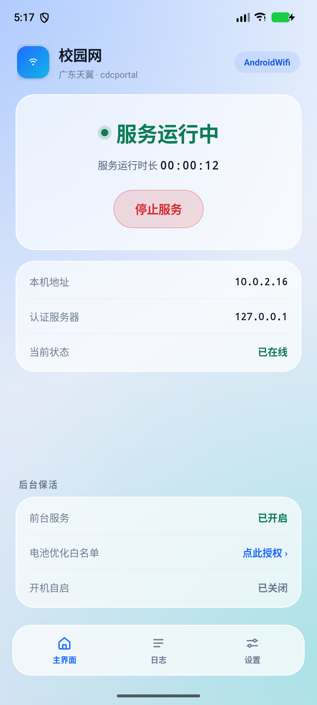 | 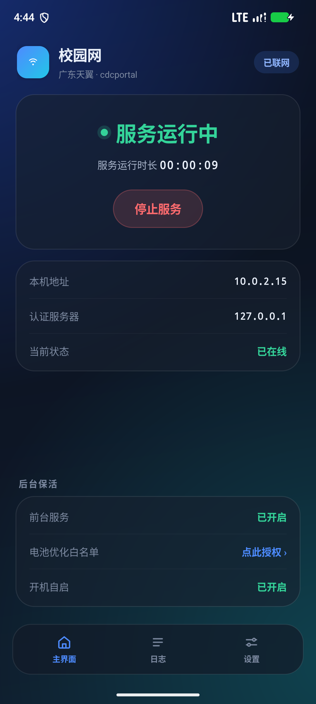 |

| 首次使用 | 未启动服务 |
| --- | --- |
| 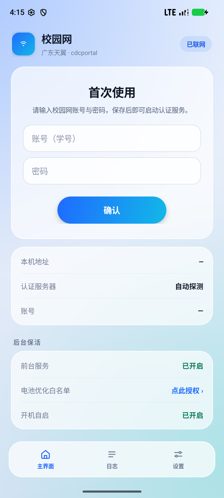 | 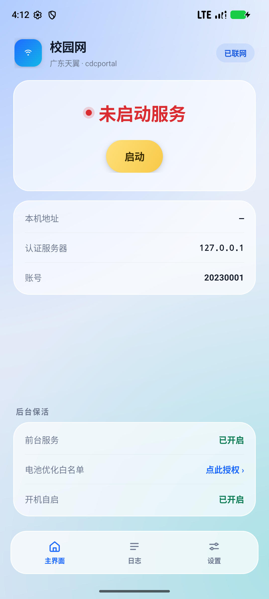 |

| 日志（实时写入） | 设置（逐项修改） |
| --- | --- |
| 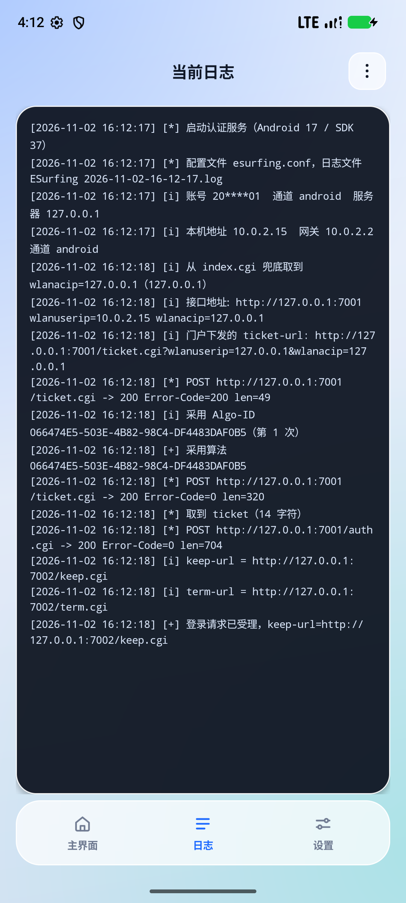 | 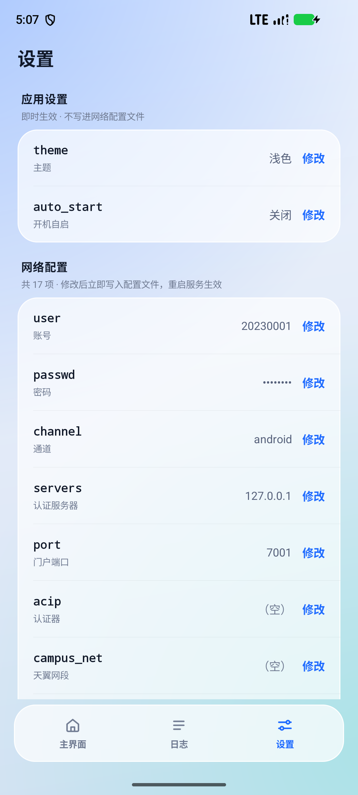 |

| 磨砂弹窗 + 高斯模糊 | 主题下拉框 | 打开日志（按启动时间命名） |
| --- | --- | --- |
| 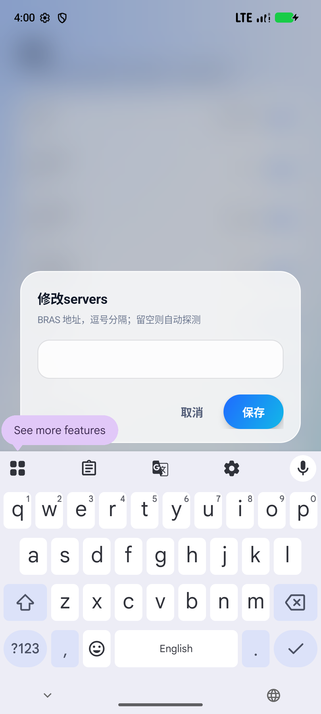 | 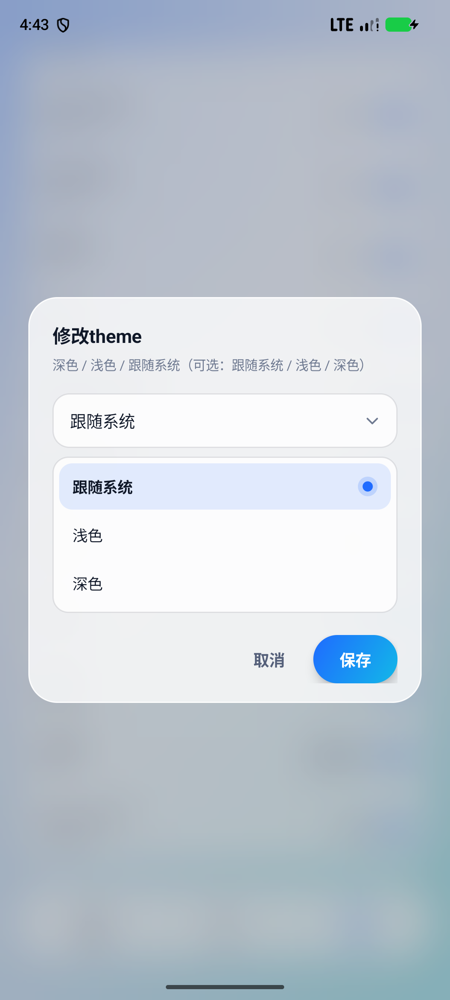 | 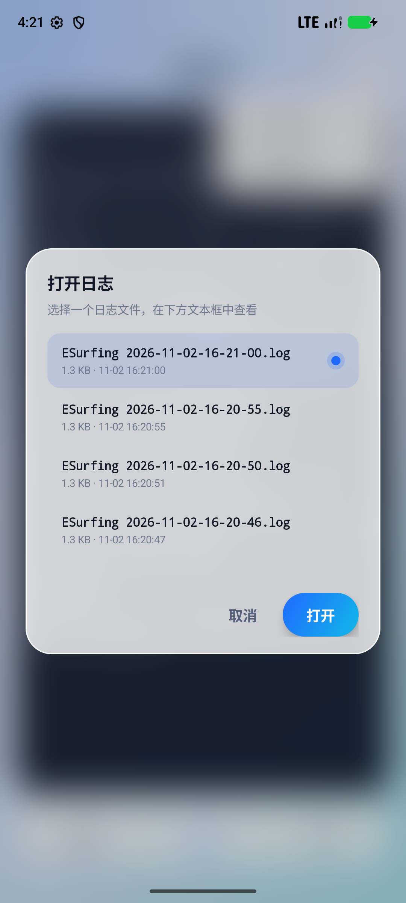 |

---

## 一、快速开始

1. 安装 `ESurfing-client.apk`（release 包用 debug 证书签名，可直接侧载；Android 12+）。
2. 首次打开输入**校园网账号 / 密码**，点「确认」。
3. 进入「设置」，按学校情况补齐 `servers`（BRAS 地址）、必要时填 `acip`、`campus_net`。
4. 回「主界面」点「**启动**」，状态变为绿色「服务运行中」，下方开始实时显示服务**运行时长**。
5. 建议点「电池优化白名单 → 点此授权」，让系统不要掐心跳。

> ⚠️ 本客户端只做 Portal 认证，**不绕过**学校的终端数限制、共享检测等策略。
> 认证成功后它会真连一次外网来判断当前是校园网还是学校 eIA 准入网；判定为 eIA 时会自动用默认浏览器打开首次认证门户。

## 二、界面

三个页面的行为：

| 界面 | 行为 |
| --- | --- |
| **主界面（首次）** | 两个输入框（账号 / 密码）+ 居中的「确认」按钮；写入配置后立即切到未启动态 |
| **主界面（未启动）** | 红色 `未启动服务` + 黄色圆角按钮 `启动` |
| **主界面（运行中）** | 绿色 `服务运行中`，下方一行**实时走表的运行时长**（`hh:mm:ss`，每秒刷新），按钮变成红色 `停止服务`（长按 = 就地重新启动）；右上角标签显示**当前连接的 Wi-Fi 名称** |
| **底部选项卡** | `主界面` / `日志` / `设置`，自绘矢量图标 + 滑动胶囊选中态 |
| **日志** | 顶部 Frame 居中显示 `当前日志`，右侧 ⠇ 下拉菜单（`打开日志` / `导出日志`）；下面只读文本框，后端日志**直接追加进这个缓冲区**并自动滚到底 |
| **设置** | 顶部「应用设置」放 `theme` / `auto_start`（存 SharedPreferences，改完**立即生效**，只提示「已保存」）；下面「网络配置」逐项显示 `<字段名> <字段值>  修改`，保存后**立即写盘**并提示「重启服务后生效」 |

- 弹窗：圆角 26dp、半透明磨砂 + 背景高斯模糊、从 0.86 缩放弹出（240 ms，Decelerate）
- 页面切换：交叉淡入 + 轻微上移缩放（230 ms），选项卡胶囊滑动（260 ms）
- 暗黑模式：`theme` 在「应用设置」里用**下拉框**选「跟随系统 / 浅色 / 深色」，保存后立即生效（Activity 重建）
- 文字对比度：浅色正文 `#101828`、深色正文 `#EAF0FA`，弱化文字也保持 4.5:1 以上
- **只走 WLAN**：认证与外网连通测试的每个 socket 都用 `Network.bindSocket` 固定到 Wi-Fi 网络，移动数据再多也不会被用到；没有连 Wi-Fi 时直接不做认证（日志写「当前没有连接 WLAN」），避免拿蜂窝网去判断「已在线」\n- 外网连通测试：认证成功后逐个探测 `generate_204` / baidu / qq，日志里逐条记 `外网探测 <url> -> <状态码>`，
  再给结论——「外网连通测试通过：在线（… 返回 204），当前是校园网（campus）」或「未通过：不在线（…）」并说明是否判为 eIA

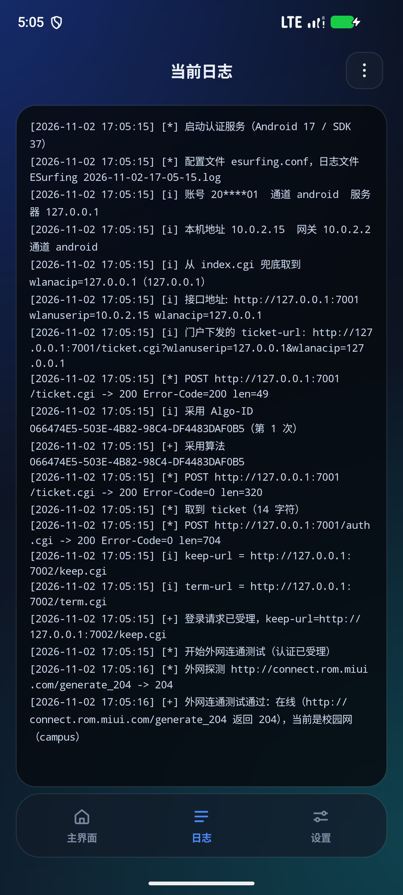

## 三、配置项

配置文件位于 App 私有目录 `files/esurfing.conf`（无需任何存储权限），首次启动自动生成带注释的模板。

| 键 | 说明 | 默认 |
| --- | --- | --- |
| `user` | 账号（学号） | 空 |
| `passwd` | 密码（列表里以 ••• 掩码显示） | 空 |
| `channel` | 通道：`android` / `windows` / `linux` / `macos` / `ios` | `android` |
| `servers` | 认证服务器（BRAS），逗号分隔；留空则自动探测 | 空 |
| `port` | 门户端口 | `7001` |
| `acip` | 认证器（AC）地址，探测不到时兜底 | 空 |
| `campus_net` | 天翼地址池网段，如 `10.0.0.0/8`；落在此网段才认证 | 空 |
| `eia_net` | 学校 eIA 准入网网段（落这里说明 MAC 未登记） | 空 |
| `eia_portal` | 准入网登记页（必须 `http://`） | 空 |
| `schoolid` / `domain` / `area` | 学校参数，多数留空 | 空 |
| `interval_min` | 心跳间隔下限（秒） | `20` |
| `net_check` | 心跳之外每隔多少秒真连一次外网校验，`0`=关闭 | `300` |
| `force` | 强制认证（探测到已在线也重新认证） | `false` |
| `mac` | 上报的 MAC，留空则每次随机（服务端不校验真伪） | 空 |
| `ssid` | 校园 WiFi 名称，仅作记录/主界面标签 | 空 |

**应用设置**（不写进上面这个文件，存在 SharedPreferences `app_prefs` 里，改完立即生效）：

| 键 | 说明 | 默认 |
| --- | --- | --- |
| `theme` | 主题：`auto`（跟随系统）/ `light` / `dark`，设置页以下拉框选择 | `auto` |
| `auto_start` | 开机自启 | `true` |

> 从旧版本升级时，如果 `esurfing.conf` 里还有 `theme` / `auto_start`，首次启动会自动迁到应用设置并把旧键从文件里删掉。

## 四、架构

```
app/src/main/java/com/esurfing/client/
├── App.java                  Application：目录、通知渠道、看门狗注册
├── core/                     ★ 后端（纯 Java，可直接在桌面 JVM 上跑）
│   ├── Aes.java              魔改 AES-128 分组算法（密钥先转置）
│   ├── DoubleAesCbc.java     双层 AES-128-CBC（IV 前缀 + 零填充）
│   ├── Algos.java            Algo-ID → key/iv 表 + 失效算法黑名单（脚本生成）
│   ├── Zsm.java              ZSM 算法模块解析
│   ├── Xml.java              ticket / auth / keep 报文构造与解析
│   ├── Http.java             极简 HTTP/1.1 客户端（socket 可绑定本机 IPv4）
│   ├── Portal.java           探测 → 取算法 → ticket → 登录 → 心跳 → 下线
│   ├── Config.java           配置读写 + 字段校验
│   ├── Log.java              日志落盘、环形缓冲、7 天清理
│   └── IpUtil.java           IPv4 / CIDR / MAC 工具
├── service/                  Android 服务层
│   ├── AuthService.java      前台服务：会话状态机、自动重连、下线、通知
│   ├── ServiceState.java     运行态（供界面订阅）
│   ├── NetInfo.java          从 ConnectivityManager 取 WiFi IPv4 / 网关
│   ├── BootReceiver.java     开机 / 应用更新后自动拉起
│   └── KeepAliveJobService.java  15 分钟看门狗（JobScheduler，持久化）
└── ui/                       前端（全自绘，无 XML 布局、无 AndroidX）
    ├── MainActivity.java     单 Activity + 页面容器 + 覆盖层栈
    ├── MainPage.java         主界面（首次 / 未启动 / 运行中三态）
    ├── LogPage.java          日志页 + ⠇ 菜单 + 实时跟随
    ├── SettingsPage.java     设置页 + 修改弹窗
    ├── FrostDialog.java      磨砂圆角弹窗（输入 / 列表两种形态）
    ├── FloatToast.java       逐渐消失的小浮窗
    ├── Blur.java             截屏 + 高斯模糊（RenderEffect / CPU 兜底）
    ├── Backdrop.java         渐变 + 柔光背景
    ├── BottomBar.java        底部选项卡 + 滑动胶囊
    ├── Theme.java            浅色 / 深色两套配色
    ├── Pill.java / Dot.java / Ui.java   自绘小组件
    └── Page.java             页面接口
```

**为什么不用 AndroidX / Kotlin / 任何库**：目标是 APK < 1 MB 且启动快。一个 `androidx.appcompat` 就接近 1 MB，
所以界面全部用 Framework 自绘（`View` + `GradientDrawable` + 矢量图标），HTTP 也自己写了 200 行。

## 五、协议实现（与参考后端对齐）

```
① 探测门户：GET generate_204 → 302 Location 里有 wlanuserip / wlanacip
             （探测不到就依次问 servers 的 index.cgi）
② 取算法：  POST ticket.cgi，body=当前 Algo-ID（首次全 0）
             服务端回 "001"-开头的 ZSM → 取出下发的 Algo-ID
             黑名单 / 未实现的算法要丢弃并换随机身份重取，直到拿到可用算法
③ 取 ticket：POST ticket.cgi，body=算法加密的 XML（大写 hex）
④ 登录：    POST auth.cgi，响应里带 keep-url / term-url（可能指向另一台 BRAS）
⑤ 心跳：    POST keep.cgi，响应给 <interval>，按它定时续约
⑥ 下线：    POST term.cgi
```

**加密**：`aes_double_cbc` —— 32 字节 key 分两层，先转置再 10 轮 S 盒/Rcon 扩展；
每层 `输出 = IV || CBC(零填充明文)`，无 PKCS7；两层叠加，解密反序并去掉尾部 `\0`。

关键实现细节与参考后端保持一致：UA 通道、`CDC-Checksum=md5(body)`、`Client-ID` / `Algo-ID` 头、
`local-time` 格式、XML 字段顺序与缩进、`wlanuserip=10.0.2.15` 校正等。

## 六、构建

需要 JDK 17+、Android SDK（compileSdk 37 / build-tools 36）、Gradle 9+（仓库内无 wrapper，用本机 Gradle 或 Android Studio 直接打开）。

```bash
gradle :app:assembleRelease   # 产物：app/build/outputs/apk/release/app-release.apk
gradle :app:assembleDebug     # 调试包
```

release 包用 debug 证书签名（`signingConfig = debug`），便于直接侧载；正式发布请换成自己的证书。

## 七、测试与验证

### 1. 加密一致性（与参考后端逐字节比对）

```powershell
# 编译 core + 开发工具（JDK 17+，不需要 Android SDK）
$core = Get-ChildItem app/src/main/java/com/esurfing/client/core/*.java | % FullName
$dev  = Get-ChildItem tools/devtest/src/com/esurfing/client/core/*.java | % FullName
javac -encoding UTF-8 -d tools/devtest/out @($core + $dev)

# 用参考后端（Python）生成 150 组向量，再用 Java 复算并比对
python tools/gen_vectors.py <参考仓库目录> tools/devtest/out/vectors.txt
java -cp tools/devtest/out com.esurfing.client.core.DevMain crypto tools/devtest/out/vectors.txt
```

结果：**150 / 150 通过**（120 组随机 key/iv/明文 + 30 组真实 Algo-ID）。

### 2. mock BRAS 全流程联调

`tools/mock-bras/mock_bras.py` 用参考后端的加解密实现了一个假门户：故意先下发黑名单算法、未实现算法，
再下发可用算法，并校验 ticket/auth/keep/term 报文。

```bash
python tools/mock-bras/mock_bras.py --ref <参考仓库目录> --user 20230001 --passwd pass1234
# 桌面：
java -cp tools/devtest/out com.esurfing.client.core.DevMain interop 127.0.0.1 7001 127.0.0.1 20230001 pass1234
# Android 模拟器：
adb reverse tcp:7001 tcp:7001 && adb reverse tcp:7002 tcp:7002
# App 设置里 servers=127.0.0.1、force=true，然后启动服务
```

客户端日志（App 内「日志」页）与 mock 服务端日志都能对上：
`丢弃 ZSM（黑名单）→ 丢弃（未实现）→ 采用算法 → 取到 ticket → 登录请求已受理 → 心跳正常`。

### 3. 模拟器实测清单（Android 17 / API 37，1080×2400）

- [x] 首次使用：输入账号密码 → 确认 → 立即写入配置并切到未启动态
- [x] 启动：黄色按钮 → 前台服务起来，主界面变绿色「服务运行中」+ **运行时长每秒走表**（实测 00:00:05 → 00:00:18 → 00:00:24）
- [x] 停止服务：红色按钮 → 确认弹窗 → 向 BRAS 发 `term.cgi`，界面回到红色「未启动服务」（长按该按钮可就地重新启动）
- [x] 日志：实时追加、自动滚屏、⠇ 菜单、`打开日志`（列表选择）、`导出日志`（SAF 另存为，写入 Downloads 成功）
- [x] 设置：19 项逐行显示、`passwd` 掩码、输入弹窗校验、保存后小浮窗「重启服务后生效」
- [x] 主题：设置里 `theme` 改成**下拉框**（跟随系统 / 浅色 / 深色），选中保存后立即重建界面并切换配色
- [x] 只走 WLAN：`svc data disable` 关掉移动数据后认证与外网测试照样跑通；`svc wifi disable` 关掉 Wi-Fi 后日志停在
      「当前没有连接 WLAN：认证与外网连通测试都只走 WLAN（不走移动数据），15 秒后重试」，不会拿蜂窝去认证
- [x] 主界面显示 Wi-Fi 名：右上角标签显示 `AndroidWifi`（读 SSID 需要 NEARBY_WIFI_DEVICES + ACCESS_FINE_LOCATION，被拒时退化成「WiFi 已连接」，点标签可再申请）
- [x] 外网连通测试落日志：`开始外网连通测试（认证已受理）` → `外网探测 … -> 204` → `外网连通测试通过：在线（… 返回 204），当前是校园网（campus）`
- [x] 应用设置独立：`theme` / `auto_start` 在设置页最上方单独成块（不写进 `esurfing.conf`），保存只提示「已保存」，主题立即切换
- [x] eIA 判定（单元）：`DevMain redirect` 用 mock 门户验证——跳到不含 `wlanuserip` 的门户判为 eIA，跳到 BRAS 门户不误判
- [x] eIA 判定（端到端）：模拟器里用 `iptables` 屏蔽 80 端口伪造"外网不通"，并设 `eia_net=10.0.2.0/24`、
      `eia_portal=http://neverssl.com`，服务日志出现「判断为学校 eIA 准入网 / 尝试用默认浏览器打开」，
      顶层 Activity 变为 `com.android.chrome`（浏览器被成功拉起）

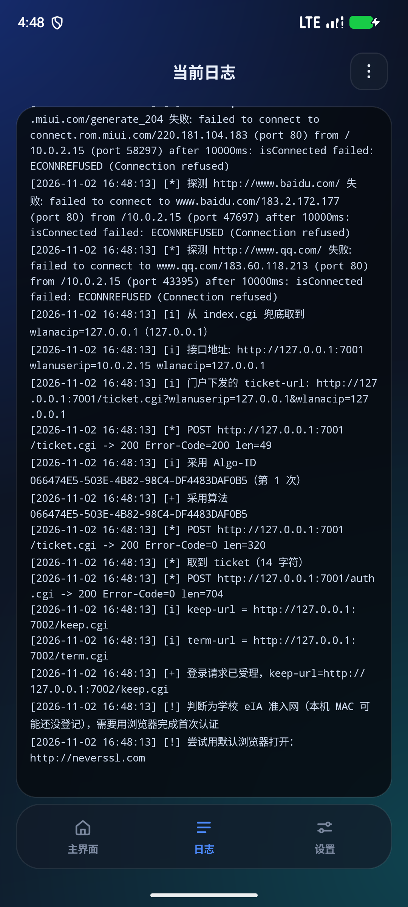
- [x] 保活：`dumpsys activity services` 显示 `isForeground=true`；应用更新（MY_PACKAGE_REPLACED）后自动重启服务
- [x] 电池优化：点「点此授权」→ 拉起系统 `RequestIgnoreBatteryOptimizations`
- [x] 长跑：登录后 60 秒首次心跳、随后按服务端 `interval=300` 续约，4 分钟内无多余重认证；
      `adb shell am force-stop` 杀掉进程后，看门狗/开机广播能把服务重新拉起并自动完成认证

> mock 服务端的访问日志里可以逐条核对：`index.cgi → ticket.cgi(ZSM) → ticket.cgi → auth.cgi → keep.cgi → …`，
> 只有主动停止/重启时才会看到 `term.cgi`。

### 4. 体积与启动

| 指标 | 数值 |
| --- | --- |
| release APK | **122 KB**（124468 字节） |
| 其中 `classes.dex` | ≈ 80 KB |
| 冷启动：进程启动 → `onCreate` 结束 | **340 ~ 450 ms** |
| 冷启动：系统 `Displayed` | 1.4 ~ 1.8 s（本机 SwiftShader 软件渲染模拟器） |

日志里带 `cold start: ...` 的埋点可以随时复核：

```
I/ESurfing: App.onCreate 开始 +115ms, 完成 +117ms
I/ESurfing: cold start: onCreate 完成，进程启动后 369ms
```

`onCreate` 之后剩下的 1 秒多都花在模拟器的**第一帧软件渲染**上（渐变 / 模糊着色器要在 CPU 上编译）；
真机有硬件加速，这部分通常只有几十毫秒。App 侧没有任何 SDK 初始化、没有线上请求、没有 XML 布局解析。

## 八、后台保活说明

| 手段 | 说明 |
| --- | --- |
| 前台服务 + 常驻通知 | `foregroundServiceType=dataSync`，通知常驻「已在线 · 启动于 hh:mm:ss」，带「重新启动 / 停止」按钮 |
| `START_STICKY` | 被系统回收后自动重建 |
| 开机自启 | `BOOT_COMPLETED` / `MY_PACKAGE_REPLACED`，应用设置里「开机自启」为开启且账号已填才启动 |
| JobScheduler 看门狗 | 每 15 分钟检查服务是否还在，被 ROM 清掉就拉起（任务持久化，重启后仍在） |
| 电池优化白名单 | 主界面「点此授权」直接拉起系统申请页，避免 Doze 掐掉心跳 |
| WiFi Lock | `WIFI_MODE_FULL_HIGH_PERF`，保证心跳时网卡不休眠 |

> 各家 ROM（MIUI / EMUI / ColorOS 等）对后台的限制差异很大，除了白名单，还建议在系统的
> 「自启动管理」里放行本应用。前台服务已经是最强的常规手段，但不能突破厂商的强制清理策略。

## 九、目录

```
app/             Android 工程（后端 core + 服务 + 自绘前端）
tools/devtest/   加密向量比对 / 联调入口（不打进 APK）
tools/mock-bras/ mock BRAS（用参考后端实现，用于联调）
tools/gen_algos.py  从参考后端生成 Algo-ID 表
docs/mockup/     前端方案示意图（实施前确认用）
docs/shots/      模拟器实测截图
```

## 十、许可证

MIT，见 [LICENSE](LICENSE)。仅供学习与个人使用；使用前请确认所在学校/运营商的服务条款。
